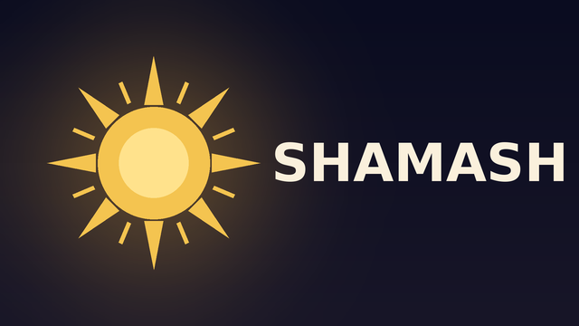

<p align="center"></p>

# Shamash

**A home screen for Android TV and Google TV that shapes itself around you.**

Shamash (the Mesopotamian Sun god, giver of light) replaces your TV's launcher. On first run it asks what you
watch, which apps you pay for, your teams and your tastes — then the whole TV follows those answers.

- **A cinematic home**: a full-screen carousel of what's worth watching on *your* services, "Good evening" and a
  *Tonight* row that change with the time of day, Continue watching, Top 10, Popular on each of your apps.
- **Match Centre**: your teams' matches with crests and live scores, a match-day billboard, a reminder 10 minutes
  before kick-off and a live score in the corner **over any app**, with a GOAL! flash.
- **One search** across all your services; results open on the title's own page where the app allows it.
- **Your phone as a magic wand**: send a link or a title from your phone to the TV.
- **YouTube for you** (optional sign-in): recommendations built from what you like and watch.
- **Lighter, faster TV**: turns off the TV maker's promo apps (never uninstalls them), closes apps you leave so the
  next one opens fast, and always lets you go back to the original home screen in one press.
- **Private**: no account, no analytics. Keys and sign-ins stay on your TV.

> Works on Android TV / Google TV 9 and newer (TVs and boxes). Tested on a TCL Google TV (Android 11).

---

## Features

- **Profiles**: a picker on start, a PIN per profile, Kids and Guest profiles, daily limits and bedtime, content levels
  (All / Family / Kids) checked on every title from every source.
- **Your Home, your way**: a row editor (hide, pin, rename, reorder), layout presets including Kids, rows that change
  with the time of day, and a *Quick start* preset in setup ("Netflix and YouTube", "Sports first"...).
- **Made for you**: recommendations from what you open and like, "Why this?" and "Not for you" on every card, and
  **one My List** across sources.
- **Match Centre**: football, F1, tennis, NBA and cricket; follow teams, players or drivers; alerts per follow (off,
  kick-off, goals, all), quiet hours, goal-only mode, and where each match is on in your region.
- **Add-ons** (each off until you turn it on): Plex, Jellyfin / Emby, IPTV (M3U + XMLTV guide), My feed (RSS, Atom,
  JSON), podcasts, radio, Twitch / Kick live, Trakt / Simkl, Cinemana, and an example template for developers.
  Credentials stay on the TV, out of logs, caches and backups.
- **Phone companion**: type for the TV, edit rows, teams and feeds, queue titles, back up and restore from your phone.
- **Backup**: one encrypted file (passphrase on the TV or phone) with profiles, layout and choices, export and import
  on the TV too.
- **Voice search** with the remote's mic or the TV assistant, in English and Arabic.
- **Accessibility**: larger text, high contrast, reduce motion, TalkBack descriptions on every card; full Arabic and
  right-to-left layout.
- **Write your own add-on**: see [docs/ADDONS.md](docs/ADDONS.md).

## Quick start

### 1. Get the code

Fork this repository on GitHub, then:

```bash
git clone https://github.com/<you>/shamash.git
cd shamash
```

### 2. Build

You need a JDK (17 or newer) and the Android SDK (platform 36). With Android Studio, just open the folder. From a
terminal:

```bash
echo "sdk.dir=$HOME/Android/Sdk" > local.properties   # where your Android SDK is
./gradlew assembleRelease                             # app/build/outputs/apk/release/app-release.apk
```

To sign your own releases, add to `local.properties` (never commit it):

```properties
signing.storeFile=/path/to/your.keystore
signing.storePassword=…
signing.keyAlias=…
signing.keyPassword=…
```

### 3. Install on the TV

On the TV: **Settings → System → About → Android TV OS build**, press OK 7 times to unlock developer options, then
**Settings → System → Developer options → USB debugging: On** (and **Network debugging** if your TV shows it).

```bash
adb connect <TV-IP>:5555          # accept "Allow USB debugging?" on the TV, tick "Always allow"
adb install -r app/build/outputs/apk/release/app-release.apk
```

Open **Shamash** from the TV's apps.

### 4. First run

Shamash asks, one screen at a time (everything except the welcome can be skipped and changed later in Settings):

1. Your first name and city (greeting, weather, the evening look)
2. **Your apps** — pick the ones you subscribe to
3. Your teams and competitions
4. What you like
5. Optional keys (see below)
6. **Make Shamash your home screen**

### 5. Make it your home screen (and undo)

The last setup step (or **Settings → Home screen**) switches the TV to Shamash using the TV's own debugging
connection: the TV asks once more to allow Shamash. It then:

- sets Shamash as the home screen and screensaver,
- turns off the TV maker's promo apps listed for your brand (never uninstalls; never touches picture, sound, inputs,
  the tuner, the remote, updates or the Play Store),
- lets Match Centre show over other apps and the *Recent apps* row read which apps you used.

**Undo:** Settings → Home screen → **Original**. Everything is turned back on and the TV's own home screen returns.
If Shamash ever crashes three times in five minutes, it does this by itself.

> If the TV's first setup saved your Wi-Fi network, Shamash stops before changing anything and asks you to forget
> the network and join it again (turning off the setup app would erase saved networks).

---

## Optional keys

All free; Shamash works without them (the parts that need one stay hidden). Enter them in setup or
**Settings → Keys**. They stay on the TV.

| Key | What it adds | Where to get it |
|---|---|---|
| **TMDB API key** | The carousel, Top 10, Popular on your apps, search across services | themoviedb.org → Settings → API → Create (Developer) |
| **YouTube OAuth client** (ID + secret) | Sign in to YouTube on the TV: Recommended for you, YouTube search | console.cloud.google.com → APIs & Services → enable *YouTube Data API v3* → OAuth consent screen (External, add yourself as a test user) → Credentials → OAuth client ID → *TVs and Limited Input devices* |

Then **Settings → YouTube → Sign in**: the TV shows a code; open google.com/device on your phone and enter it.

## Your phone as a remote

**Settings → Phone remote** shows an address like `http://192.168.1.20:8765` and a 4-digit PIN. Open the address in
your phone's browser (same Wi-Fi), enter the PIN once, then paste a YouTube or TOD link — or type a title — and send.
Add the page to your phone's home screen for one-tap access.

## Add-ons

- **Cinemana** (off by default): a full Netflix-style app for Cinemana's catalog (browse, previews, title pages, a
  player with subtitles). Turn it on in **Settings → Add-ons**. It lives entirely in `data/cinemana` and
  `feature/cinemana`; delete those folders (and its line in `data/Sources.kt`) to remove it from your fork.
- **Plex, Jellyfin / Emby, IPTV, My feed, podcasts, radio, Twitch / Kick, Trakt / Simkl**: each has its own fields,
  *Test connection*, the rows it offers and *Remove* in **Settings → Add-ons**.
- **Write your own**: the [add-on authoring guide](docs/ADDONS.md) and the template in
  `app/src/main/java/io/shamash/addons/example`. Every add-on can be deleted from a fork by removing its folders and
  its one line in `data/Sources.kt`, plus any hook line the guide lists (a test checks this).

---

## Troubleshooting

| Problem | Fix |
|---|---|
| "Allow USB debugging?" never appears | Turn USB debugging off and on, then `adb connect` again |
| The switch says it can't reach the TV's debugging | Developer options → USB/Network debugging must be on |
| Pressing Home asks which home screen to use | Another launcher app is installed; uninstall it or pick Shamash → *Always* |
| No carousel / Popular rows | Add a TMDB key (Settings → Keys) |
| The remote's Netflix/YouTube buttons stopped working | Settings → Home screen → switch again (Android turns accessibility services off after updates) |
| Slow full start (TV logo, Google TV animation) | That's the TV booting after a power cut; use the remote's power button (instant on). A small UPS helps where power cuts are common |

## For developers

Shamash is **spec-driven**: every capability is a list of numbered requirements in [`docs/specs`](docs/specs) and
code/tests point back to them (`// SPEC: HOME-04`). Change behavior by changing the spec first.

```
app/src/main/java/io/shamash/
  app/        activity shell, navigation, the Opener, the service locator
  ui/         design system (theme, focus motion, billboard, rows, cards)
  feature/    onboarding, home, search, settings, matchcentre, companion, tvcontrol, screensaver, cinemana (add-on)
  domain/     models, the Provider contract, pure logic (moments, carousel, ranking)
  data/       TMDB, JustWatch, YouTube, TOD, ESPN, weather, Cinemana, preferences, history
  addons/     the example add-on template (see docs/ADDONS.md)
```

- Add a content source: implement `domain.Provider` in `data/<name>/` and list it in `data/Sources.kt`; for an
  optional one, write an add-on ([docs/ADDONS.md](docs/ADDONS.md)).
- Add a TV brand: add its promo apps to `feature/tvcontrol/BrandProfiles.kt` (one reason per line).
- Run the tests: `./gradlew testDebugUnitTest`.

## License

MIT — see [LICENSE](LICENSE).
